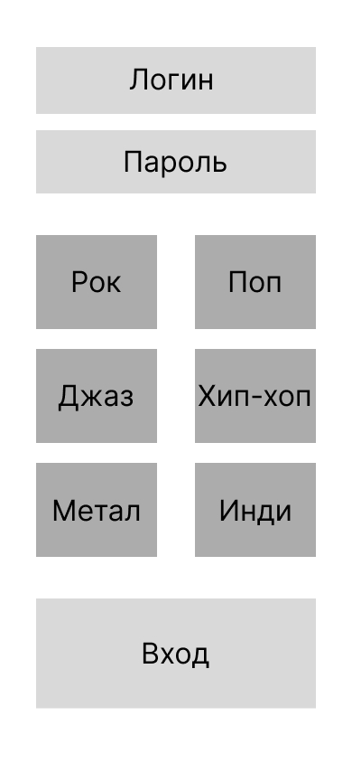
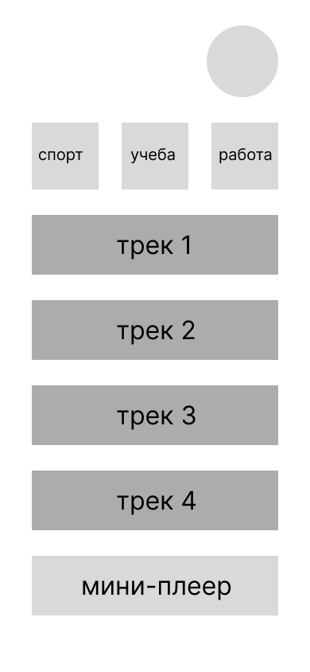
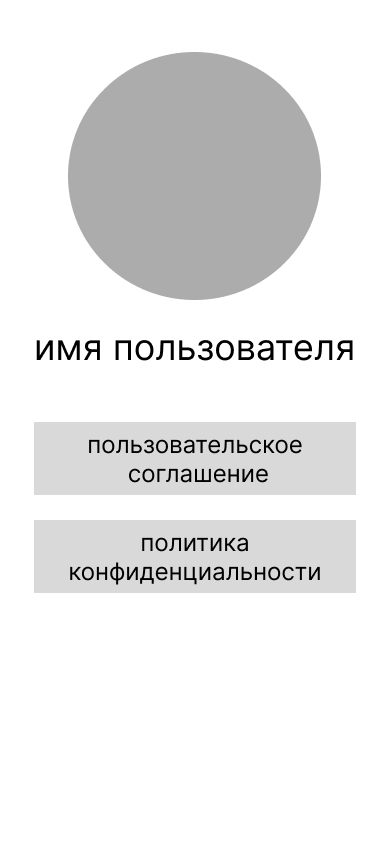

Отчёт по самостоятельной работе №5
Тема: Разработка интерфейса сервиса рекомендаций музыкальных произведений
Команда: Muz-Arbuz 

1. Перечень экранов и их назначение
Для реализации требований из СР4 и соблюдения правовых норм (СР2) достаточно четырех ключевых экранов (мобильная версия):
1. Экран авторизации/настройки. Назначение: вход в систему и выбор любимых жанров (первичная настройка).
2. Главный экран. Назначение: выбор настроения и вывод списка рекомендованных треков.
3. Экран плеера. Назначение: воспроизведение музыки, оценка трека и чтение текста.
4. Экран профиля. Назначение: доступ к настройкам и правовой информации.

2. Элементы основных экранов (для мобильной версии)
Экран авторизации/настройки:
- Поля ввода (логин/пароль).
- Кнопка «Войти».
- Кнопка «Продолжить» (активна после выбора 3+ жанров).

Главный экран:
- Верхняя панель (иконка профиля).
- Кнопки настроений («Спорт», «Учеба», «Отдых»).
- Список треков (10 штук).
- Мини-плеер внизу.

Экран плеера:
- Обложка, название трека.
- Кнопка «Дизлайк» (исключить исполнителя).
- Кнопка «Текст» (показать слова песни).
- Кнопки «Пауза» и «Далее».

Экран профиля:
- Аватар, имя пользователя.
- Кнопки перехода к документам (Пользовательское соглашение, Политика конфиденциальности).

3. Карта навигации
 

- Экран авторизации -> Главный экран (после входа и настройки).
- Главный экран -> Экран плеера (нажатие на трек).
- Главный экран -> Экран профиля (нажатие на иконку).
- Экран профиля -> Правовые документы.
- Из любого экрана доступен возврат на Главный экран (кнопка «Назад»).

4. Обоснование решений
Согласно СР3, пользователи слушают музыку в дороге и на учебе, поэтому интерфейс спроектирован для мобильных устройств (крупные кнопки, вертикальная ориентация). Для решения проблемы нерелевантных рекомендаций на экране плеера добавлена кнопка «Дизлайк», а для поиска под настроение — кнопки на Главном экране. Правовая информация вынесена в профиль, чтобы не перегружать основной интерфейс.

5. Скетчи (макеты) основных экранов
   

6. Вывод
Спроектирован мобильный интерфейс из четырех экранов. Он закрывает функциональные требования из СР4, решает проблемы аудитории из СР3 и содержит необходимые правовые разделы.

 Участие принял: Потапкин Н.А. , Романов Р.Д., Симонов Н.М.
